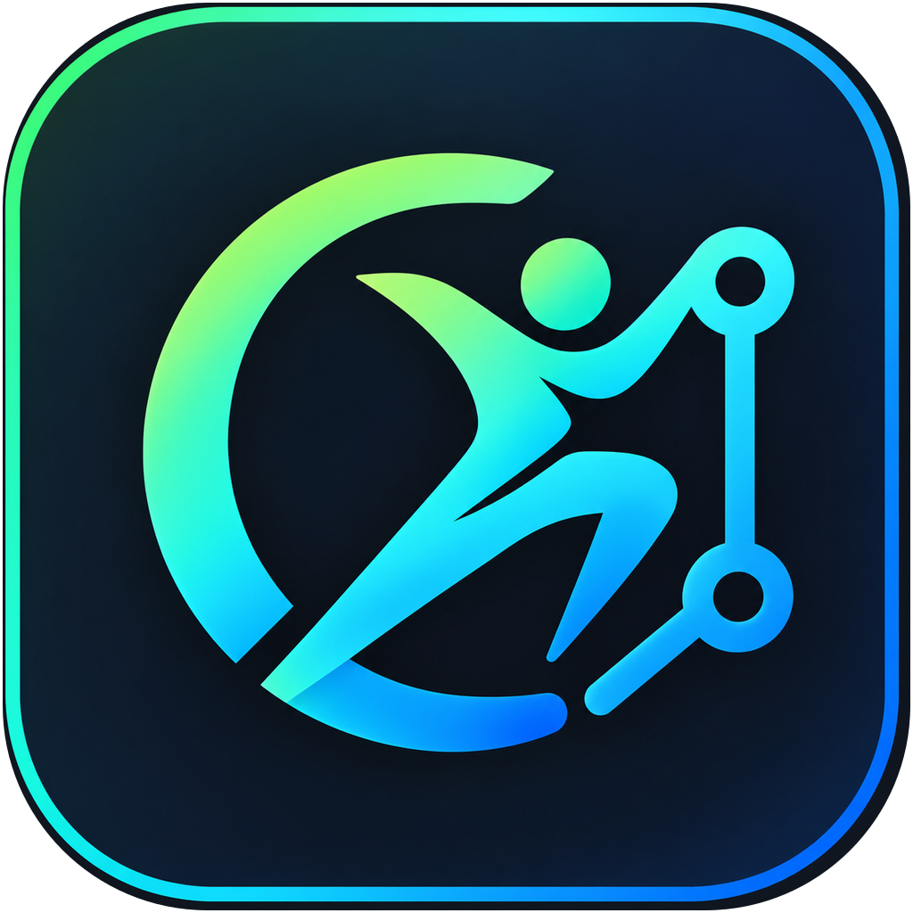
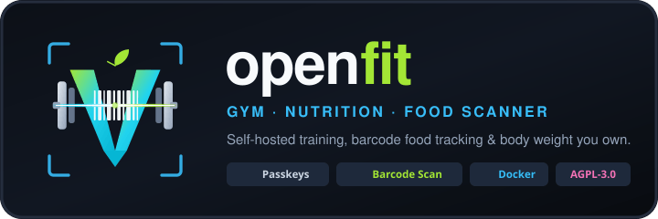
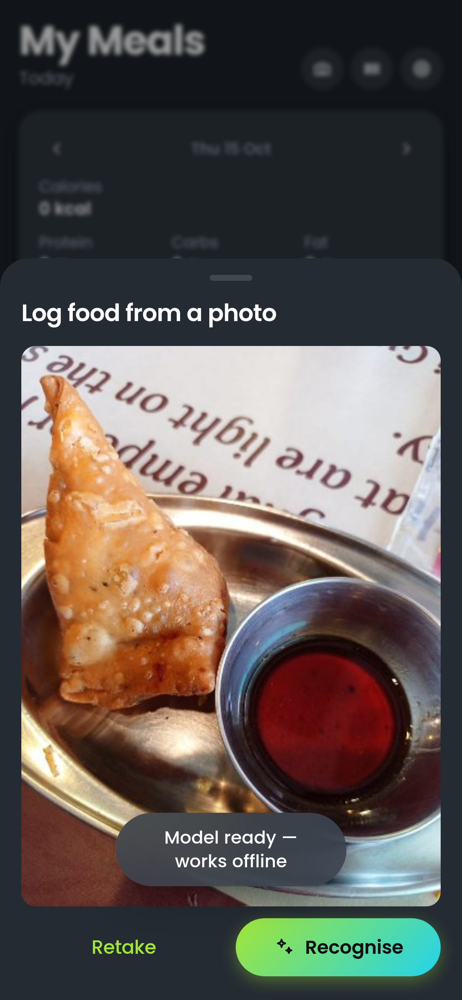
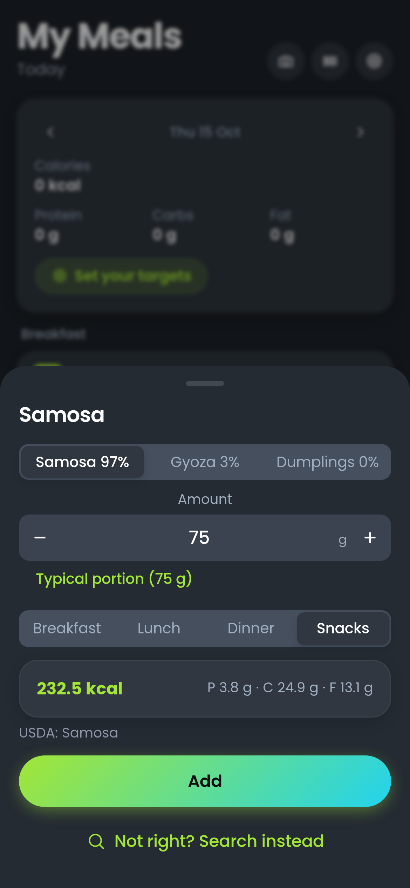
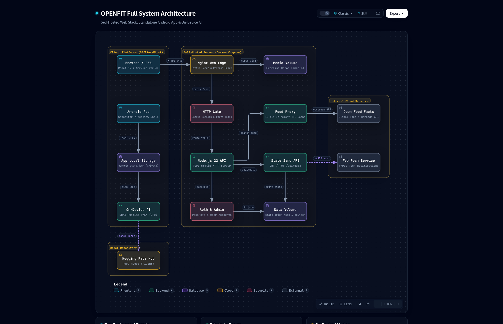
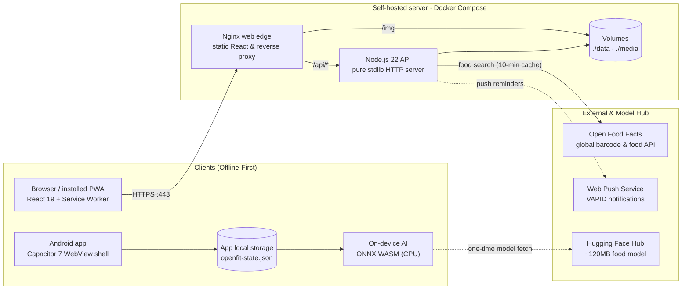

<div align="center">



# OPENFIT

**Self-hosted training, body-weight and nutrition tracking that you own.**

Plan routines, run guided workouts with automatic progressive overload, log meals by search or barcode, and track body weight, all in one app that runs on your own server.

[](LICENSE)


[](https://github.com/rupal2k/openfit/releases/latest/download/OPENFIT-android.apk)



<br><br>


</div>

---

## Why OPENFIT

Fitness apps tend to put your own training history behind a subscription, or lose it when the company changes direction. OPENFIT keeps the data with you:

- **Self-hosted:** one Docker Compose stack on your server or home lab, with no external database.
- **One app:** workouts, progressive overload, body weight and nutrition live in one place.
- **Private by default:** passkey sign-in, no ads, no telemetry, and plain JSON files on disk.
- **Works where you train:** an installable PWA and an Android app, with offline caching and wake-lock during sessions.
- **No lock-in:** one-tap JSON backups, plus CSV and JSON import and export.

## Features

### Training
| | |
|---|---|
| **Exercise library** | 1,300+ exercises, searchable by name, muscle or equipment, each with an animated demo. |
| **Guided workouts** | Weights pre-filled from your last session, rest timers, supersets and PR detection. |
| **Progressive overload** | Linear, Greyskull LP, double progression and time progression. Each target explains why it was chosen. |
| **Effort tracking** | Optional RIR or RPE column, estimated 1RM, and per-exercise progress curves. |
| **Insights** | 12-month activity heatmap, and a front/back muscle-balance map that highlights neglected muscles. |

### Nutrition
| | |
|---|---|
| **Daily diary** | Breakfast, lunch, dinner and snacks, with live calorie and macro totals. |
| **Food search** | Open Food Facts search through a cached server-side proxy. |
| **Barcode scanner** | Native camera scanning with HD capture, tap-to-focus, zoom and torch. Manual code entry as a fallback. |
| **Photo logging (on-device AI)** | Snap a dish and OPENFIT recognises it (101 common dishes) with a small Hugging Face model (~120 MB incl. runtime, downloaded once and verified) that runs on your device. Nutrition and the typical portion come from USDA data. Photos are never uploaded, and it works offline. |
| **Flexible portions** | Log by serving, grams, kilograms, ounces or millilitres. Product serving sizes are detected automatically. |
| **Science-based targets** | IOM 2005 energy equations with a lifter-focused protein target of 1.6 g/kg. |
| **History stays accurate** | Each entry snapshots the food's nutrition values, so later database edits never rewrite old logs. |

<div align="center">
<table>
<tr>
<td align="center"><br><sub><b>Snap a dish</b><br>Recognised on your device</sub></td>
<td align="center"><br><sub><b>Review and log</b><br>Top-3 guesses, USDA portion and macros</sub></td>
</tr>
</table>
</div>

### Planning & data
| | |
|---|---|
| **Weekly planner** | Assign routines to days, reschedule, or start from built-in templates. |
| **Spreadsheet import** | Build plans in Excel or Google Sheets and import them as CSV or JSON. Sample plans are in [`samples/`](samples). |
| **History import** | Bring in past workouts from FitNotes, Strong, Hevy and Apple Health. |
| **Printable plans** | Clean one-page workout cards for the gym binder. |
| **Multi-user** | Profiles sync across devices, with an optional admin dashboard and invite-only sign-up. |
| **12 languages** | The full interface is localised, with matching exercise instructions. |

## Tech stack

| Layer | Technology |
|---|---|
| **Frontend** |      |
| **Mobile** |    |
| **Backend** |    |
| **On-device AI** |    |
| **Data** |    |
| **Ops & tests** |   |

## Architecture

One React codebase ships two ways: a **self-hosted web app** (nginx + a small Node.js API, data as JSON files) and a **standalone Android app** (Capacitor, no server).

<p align="center">
  <picture>
    <source media="(prefers-color-scheme: dark)" srcset="docs/images/architecture.png">
    <source media="(prefers-color-scheme: light)" srcset="docs/images/architecture-light.png">
    
  </picture>
</p>

> [!TIP]
> **Interactive Architecture Diagram**: An interactive showcase diagram is available in [`docs/architecture.html`](docs/architecture.html) — open it in any browser to explore subsystem filters (Self-Hosted Web, Standalone Android, On-Device AI Vision, Food Search Proxy), inspect components, and trace data-flow paths.

<details>
<summary><b>View GitHub-native Mermaid Diagram</b></summary>



</details>

The web request path, the code layers (presentation / state / domain / adapters) and a mapping to Android Clean Architecture are in **[docs/ARCHITECTURE.md](docs/ARCHITECTURE.md)**.

## Quick start

**Requirements:** [Docker](https://docs.docker.com/get-docker/) with Compose.

```bash
git clone https://github.com/rupal2k/openfit.git
cd openfit
cp .env.example .env
docker compose up -d --build
```

Open <http://localhost:8080>, choose **Create profile** and register a passkey. On first run the stack downloads and caches the exercise media (~140 MB).

> **Note:** browsers only allow passkeys over HTTPS (except on `localhost`). For public access, put OPENFIT behind a TLS reverse proxy (Caddy, Traefik, Cloudflare Tunnel or similar) and set `RP_ID` and `ORIGIN`.

### Configuration

| Variable | Purpose | Default |
|---|---|---|
| `RP_ID` | Hostname that passkeys are bound to | `localhost` |
| `ORIGIN` | Full public origin of the instance | `http://localhost:8080` |
| `WEB_PORT` | Host port for the web service | `8080` |
| `RP_NAME` | Name shown in passkey prompts | `openfit` |
| `ADMIN_UIDS` | Comma-separated user IDs with admin access | — |
| `INVITE_ONLY` | `1` requires an invite code to register | `0` |

### Backups

All state lives in `./data`:

| File | Contents |
|---|---|
| `db.json` | Accounts and public passkey credentials |
| `state-<uid>.json` | Workouts, routines, body weight and food diary |
| `secret` | Session signing key |
| `vapid.json` | Web-push keys |

```bash
tar -czf openfit-backup.tar.gz data/
```

## Android app

**[⬇ Download the latest APK](https://github.com/rupal2k/openfit/releases/latest/download/OPENFIT-android.apk)** (sideload: allow "Install unknown apps" for your browser or file manager). All releases: [Releases](https://github.com/rupal2k/openfit/releases).

The Android build is a standalone Capacitor app. Data stays on the device, and food search calls Open Food Facts directly.

```bash
cd frontend
npm install
npm run build:mobile                 # web bundle + cap sync
cd android && ./gradlew assembleDebug  # APK in app/build/outputs/apk/debug/
```

## Development

```bash
cd frontend
npm install
npm run dev        # Vite dev server
npx vitest run     # unit tests
npm run build      # production bundle
```

To regenerate every icon, splash screen and the banner from `assets/icon-source.png`, run `node scripts/generate-brand.mjs`.

## Acknowledgements

OPENFIT builds on these open-source projects:

- **[openGym](https://github.com/DuarteSantos8/openGym)** by Duarte Santos: the upstream tracker this project forks (AGPL-3.0).
- **[OpenNutriTracker](https://github.com/simonoppowa/OpenNutriTracker)** by Simon Oppowa: energy and macro equations (GPL-3.0).
- **[Open Food Facts](https://world.openfoodfacts.org)**: open food database (ODbL).
- **[MuscleMap](https://github.com/melihcolpan/MuscleMap)** by Melih Colpan: anatomical outlines (MIT).
- **[exercises-dataset](https://github.com/hasaneyldrm/exercises-dataset)** by hasaneyldrm: exercise catalogue and animations.

Full notices are in [`NOTICE.md`](NOTICE.md).

## License

[GNU Affero General Public License v3.0 or later](LICENSE).
