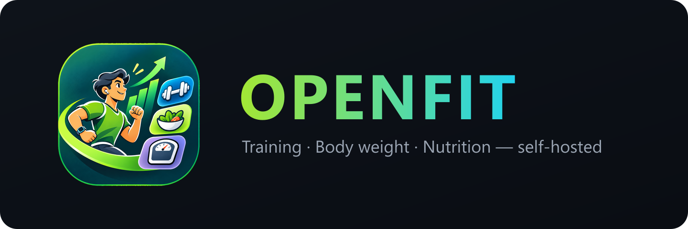
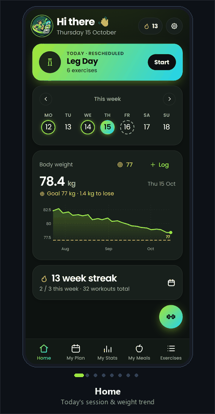
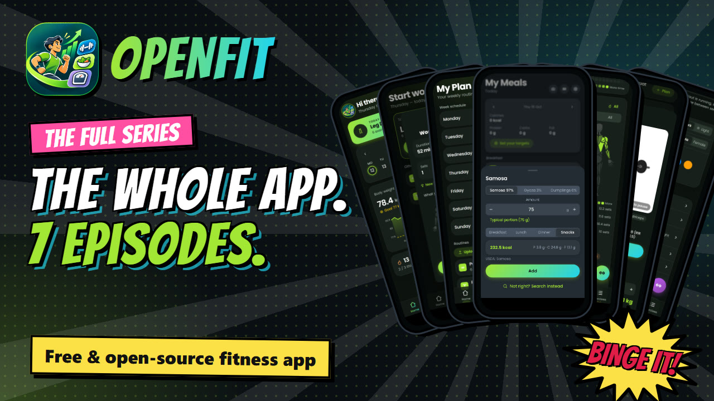
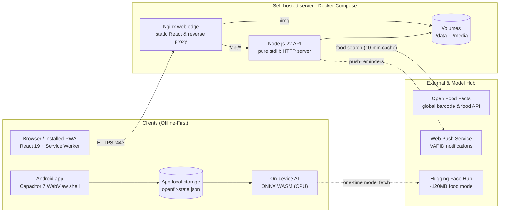

<div align="center">



<h1>OPENFIT</h1>

**Self-hosted training, body-weight and nutrition tracking that you own.**

Plan routines, run guided workouts with automatic progressive overload, log meals by search or barcode, track body weight, and read your blood-test reports on your own device, all in one app that runs on your own server.

[](LICENSE)
[](https://github.com/rupal2k/openfit/releases/latest)
[](https://github.com/rupal2k/openfit/actions/workflows/ci.yml)


[](https://github.com/rupal2k/openfit/releases/latest/download/app-release.apk)
[](https://www.youtube.com/playlist?list=PLIlQz5UNxQ1c)

<br>



</div>

---

## Video tour

Seven short comic-style episodes, one per module, about a minute and a half each.

<a href="https://www.youtube.com/playlist?list=PLIlQz5UNxQ1c"></a>

[1. Today](https://www.youtube.com/watch?v=hB6LLFcCpPI&list=PLIlQz5UNxQ1c) · [2. Guided workouts](https://www.youtube.com/watch?v=LpxnzEjcCTc&list=PLIlQz5UNxQ1c) · [3. My Plan](https://www.youtube.com/watch?v=-yHLYWLfpzE&list=PLIlQz5UNxQ1c) · [4. My Meals](https://www.youtube.com/watch?v=w5pAtuHNU38&list=PLIlQz5UNxQ1c) · [5. My Stats](https://www.youtube.com/watch?v=JdfB-Oq2mR8&list=PLIlQz5UNxQ1c) · [6. Exercise library](https://www.youtube.com/watch?v=1WvinN-iHXM&list=PLIlQz5UNxQ1c) · [7. Settings & backups](https://www.youtube.com/watch?v=ZjggkLvZ_64&list=PLIlQz5UNxQ1c)

## Why OPENFIT

Fitness apps tend to put your own training history behind a subscription, or lose it when the company changes direction. OPENFIT keeps the data with you:

- **Self-hosted:** one Docker Compose stack on your server or home lab, with no external database.
- **One app:** workouts, progressive overload, body weight, nutrition and blood tests live in one place.
- **Private by default:** passkey sign-in, no ads, no telemetry, and plain JSON files on disk. Fonts and the OCR model ship with the app, so opening it or reading a blood test sends nothing to Google or anyone else.
- **Works where you train:** an installable PWA and an Android app, with offline caching and wake-lock during sessions.
- **No lock-in:** one-tap JSON backups, plus CSV and JSON import and export.

## Features

### Training
| | |
|---|---|
| **Exercise library** | 1,300+ exercises, searchable by name, muscle or equipment, each with an animated demo. |
| **Guided workouts** | Weights pre-filled from your last session, rest timers, supersets and PR detection. |
| **Progressive overload** | Linear, Greyskull LP, double progression and time progression. Each target explains why it was chosen. |
| **Effort tracking** | Optional RIR or RPE column, estimated 1RM, and per-exercise progress curves. |
| **Insights** | 12-month activity heatmap, and a front/back muscle-balance map that highlights neglected muscles. |

### Nutrition
| | |
|---|---|
| **Daily diary** | Breakfast, lunch, dinner and snacks, with live calorie and macro totals. |
| **Food search** | Open Food Facts search through a cached server-side proxy. |
| **Barcode scanner** | Native camera scanning with HD capture, tap-to-focus, zoom and torch. Manual code entry as a fallback. |
| **Photo logging (on-device AI)** | Snap a dish and OPENFIT recognises it (101 common dishes) with a small Hugging Face model (~120 MB incl. runtime, downloaded once and verified) that runs on your device. Nutrition and the typical portion come from USDA data. Photos are never uploaded, and it works offline. |
| **Flexible portions** | Log by serving, grams, kilograms, ounces or millilitres. Product serving sizes are detected automatically. |
| **Science-based targets** | IOM 2005 energy equations with a lifter-focused protein target of 1.6 g/kg. |
| **History stays accurate** | Each entry snapshots the food's nutrition values, so later database edits never rewrite old logs. |

### Blood tests
| | |
|---|---|
| **Lab report import** | Import a lab report PDF and OPENFIT reads it on your device in about a second, with no AI model and nothing uploaded (68 of 68 results on the [getbased](https://github.com/elkimek/get-based) reference report). The sample date is filled in when the report shows it. Check every value, unit and range before you save; Save stays on screen however long the list is. Files up to 25 MB, text PDFs up to 30 pages. |
| **Photos and scans** | Photograph a printed report or import a scanned PDF: on-device OCR (Tesseract, bundled in the app, works offline) reads it, puts back decimal points OCR drops and flags every value it changed or was unsure of. Flagged rows start unticked, and OPENFIT asks for the sample date when the report has none. Photos up to 120 megapixels. |
| **Trends** | Every marker gets a chart over time, with High and Low against the lab's own range, in SI or US units. |
| **Published scores** | HOMA-IR, TG/HDL, ApoB/ApoA1, FIB-4, non-HDL cholesterol, homocysteine and Omega-3 Index, plus a PhenoAge biological-age estimate, each with its formula and source. Scores use each marker's latest value from the last 120 days, so a partial follow-up report keeps them. Information, not medical advice. |
| **Private by design** | Only the birth year and the import type (PDF, scan or photo) are stored with a report, never the file name or the full date of birth. On Android, your data is left out of Google's cloud backup. |

### Planning & data
| | |
|---|---|
| **Weekly planner** | Assign routines to days, reschedule, or start from built-in templates. |
| **Spreadsheet import** | Build plans in Excel or Google Sheets and import them as CSV or JSON. Sample plans are in [`samples/`](samples). |
| **History import** | Bring in past workouts from FitNotes, Strong and Hevy, and body-weight history from Apple Health. |
| **Printable plans** | Clean one-page workout cards for the gym binder. |
| **Multi-user** | Profiles sync across devices, with an optional admin dashboard and invite-only sign-up. |
| **12 languages** | The full interface is localised, with matching exercise instructions. |

## Tech stack

| Layer | Technology |
|---|---|
| **Frontend** | React 19, Vite 8, Zustand 5, JavaScript (ESM), offline PWA |
| **Mobile** | Capacitor 7 (Android WebView), Gradle |
| **Backend** | Node.js 22, WebAuthn passkeys, nginx proxy |
| **On-device AI** | transformers.js 4.3, ONNX Runtime (WASM), WebAssembly on the CPU |
| **Data** | Open Food Facts (ODbL), USDA FNDDS, JSON files on disk |
| **Ops & tests** | Docker Compose, Vitest 4 |

## Architecture

One React codebase ships two ways: a **self-hosted web app** (nginx + a small Node.js API, data as JSON files) and a **standalone Android app** (Capacitor, no server).

> [!TIP]
> **Interactive architecture diagram:** download [`docs/architecture.html`](docs/architecture.html) and open it in a browser (GitHub shows only its source) to explore subsystem filters (Self-Hosted Web, Standalone Android, On-Device AI Vision, Food Search Proxy), inspect components, and trace data-flow paths.



The web request path, the code layers (presentation / state / domain / adapters) and a mapping to Android Clean Architecture are in **[docs/ARCHITECTURE.md](docs/ARCHITECTURE.md)**.

## Deploy

> **Self-hosting is the recommended path** — two long-running services (web and API) plus a one-time media download, all started with one command. Cloud options are listed under [Cloud deploy](#cloud-deploy) but are untested.

### Self-hosted with Docker Compose (recommended)

**Requirements:** [Docker](https://docs.docker.com/get-docker/) with Compose.

```bash
git clone https://github.com/rupal2k/openfit.git
cd openfit
cp .env.example .env
# edit .env — set RP_ID and ORIGIN at minimum
docker compose up -d --build
```

Open <http://localhost:8080>, choose **Create profile** and register a passkey. On first run the stack downloads and caches the exercise media (~140 MB).

**Minimum `.env` for a public instance:**
```env
RP_ID=yourdomain.com
ORIGIN=https://yourdomain.com
TRUST_PROXY=2
```

The session signing key and web-push keys are generated on first start and stored in `./data` (see [Backups](#backups)); there is nothing to set for them.

> **TLS note:** browsers require HTTPS for passkeys (except on `localhost`). Put OPENFIT behind Caddy, Traefik, or Cloudflare Tunnel, set `RP_ID`/`ORIGIN` to your public domain, and set `TRUST_PROXY=2` so rate limiting sees each visitor's real IP.

---

## Configuration & backups

### Configuration

| Variable | Purpose | Default |
|---|---|---|
| `RP_ID` | Hostname that passkeys are bound to | `localhost` |
| `ORIGIN` | Full public origin of the instance | `http://localhost:8080` |
| `WEB_PORT` | Host port for the web service | `8080` |
| `RP_NAME` | Name shown in passkey prompts | `openfit` |
| `ADMIN_UIDS` | Comma-separated user IDs with admin access | — |
| `INVITE_ONLY` | `1` requires an invite code to register | `0` |
| `TRUST_PROXY` | Proxies in front of the API: `1` = bundled nginx only, `2` = also behind Caddy, Traefik or Cloudflare Tunnel | `1` |
| `RATE_LIMIT_MAX` | Max sign-in requests per IP per minute | `20` |

All variables, with risk notes, are in [`docs/VARIABLES.md`](docs/VARIABLES.md).

### Backups

All state lives in `./data`:

| File | Contents |
|---|---|
| `db.json` | Accounts and public passkey credentials |
| `state-<uid>.json` | Workouts, routines, body weight and food diary |
| `secret` | Session signing key |
| `vapid.json` | Web-push keys |

```bash
# Manual backup
tar -czf openfit-backup.tar.gz data/

# Daily scheduled backup (add to crontab: crontab -e)
0 3 * * * cd /path/to/openfit && tar -czf ~/backups/openfit-$(date +\%F).tar.gz data/
```

## Cloud deploy

> [!WARNING]
> **Untested.** None of these cloud paths has been verified end to end, and some are known not to work as written (for example, the Render blueprint uses the free plan, which has no persistent disk). Use [Self-hosted with Docker Compose](#self-hosted-with-docker-compose-recommended) for a supported install. Fixes and reports are welcome.

These options are for managed hosting without a VPS.

### Render

[](https://render.com/deploy?repo=https://github.com/rupal2k/openfit)

Deploys two services (API + web) from the `render.yaml` in this repo:

1. Click **Deploy to Render** above and connect your GitHub account.
2. After the deploy finishes, open the **openfit-api** service → **Environment** and set:
   - `RP_ID` → your Render web domain, e.g. `openfit-web.onrender.com`
   - `ORIGIN` → `https://openfit-web.onrender.com`
3. Redeploy the API service to apply the changes.

> **Note on persistence:** The API service uses a 1 GB managed disk (`./data`). Render's free tier does not include persistent disks — you'll need the Starter plan ($7/month) or above. Without a disk, data resets on every deploy.

---

### Railway

Railway can import the `docker-compose.yml` directly:

```bash
# One-time setup
npm install -g @railway/cli
railway login
railway init            # creates a new project
railway up              # deploys both services from docker-compose.yml
```

Set `RP_ID` and `ORIGIN` in the Railway dashboard to your project's domain, then redeploy.

---

### Fly.io

```bash
fly auth login
fly launch --name openfit --region iad   # detects Dockerfile, prompts for config
fly volumes create openfit_data --size 1  # persistent data volume
fly deploy
```

Set `RP_ID` and `ORIGIN` as secrets:

```bash
fly secrets set RP_ID=openfit.fly.dev ORIGIN=https://openfit.fly.dev
```

---

### Coolify / Portainer (home lab)

Paste the repo URL into Coolify's **New Resource → Docker Compose** flow. Copy `.env.example` to `.env`, set `RP_ID` and `ORIGIN` to your domain, and deploy. Coolify handles TLS via Let's Encrypt automatically.

---

**After any cloud deploy**, complete the [`docs/VARIABLES.md`](docs/VARIABLES.md) pre-go-live checklist — especially setting `ADMIN_UIDS` and configuring rate limiting.

## Android app

**[⬇ Download the latest APK](https://github.com/rupal2k/openfit/releases/latest/download/app-release.apk)** (sideload: allow "Install unknown apps" for your browser or file manager). All releases: [Releases](https://github.com/rupal2k/openfit/releases).

The Android build is a standalone Capacitor app. Data stays on the device, and food search calls Open Food Facts directly. Your data is left out of Google's cloud backup: moving to a new phone (Android 12 or later) copies it across, and **Settings → Export backup** works on any version.

```bash
cd frontend
npm install
npm run build:mobile                 # web bundle + cap sync
cd android && ./gradlew assembleDebug  # APK in app/build/outputs/apk/debug/
```

## Development

```bash
cd frontend
npm install
npm run dev        # Vite dev server
npx vitest run     # unit tests
npm run build      # production bundle
```

To regenerate every icon, splash screen and the banner from `assets/icon-source.png`, run `node scripts/generate-brand.mjs`.

## Acknowledgements

OPENFIT builds on these open-source projects:

- **[openGym](https://github.com/DuarteSantos8/openGym)** by Duarte Santos: the upstream tracker this project forks (AGPL-3.0).
- **[OpenNutriTracker](https://github.com/simonoppowa/OpenNutriTracker)** by Simon Oppowa: energy and macro equations (GPL-3.0).
- **[Open Food Facts](https://world.openfoodfacts.org)**: open food database (ODbL).
- **[MuscleMap](https://github.com/melihcolpan/MuscleMap)** by Melih Colpan: anatomical outlines (MIT).
- **[exercises-dataset](https://github.com/hasaneyldrm/exercises-dataset)** by hasaneyldrm: exercise catalogue and animations.
- **[getbased](https://github.com/elkimek/get-based)** by elkimek: blood-test markers, unit factors and the synthetic reference report used in tests (AGPL-3.0).
- **[Tesseract.js](https://github.com/naptha/tesseract.js)** and **[pdf.js](https://github.com/mozilla/pdf.js)**: on-device OCR and PDF reading (Apache-2.0).
- **[Poppins](https://github.com/itfoundry/Poppins)**: the interface font, bundled with the app (SIL OFL 1.1).

Full notices are in [`NOTICE.md`](NOTICE.md).

## License

[GNU Affero General Public License v3.0 or later](LICENSE).
