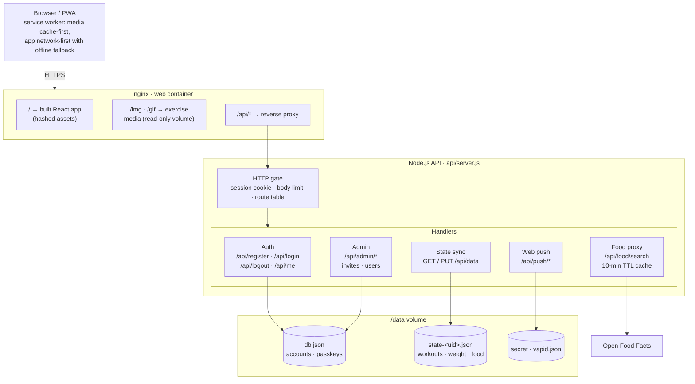
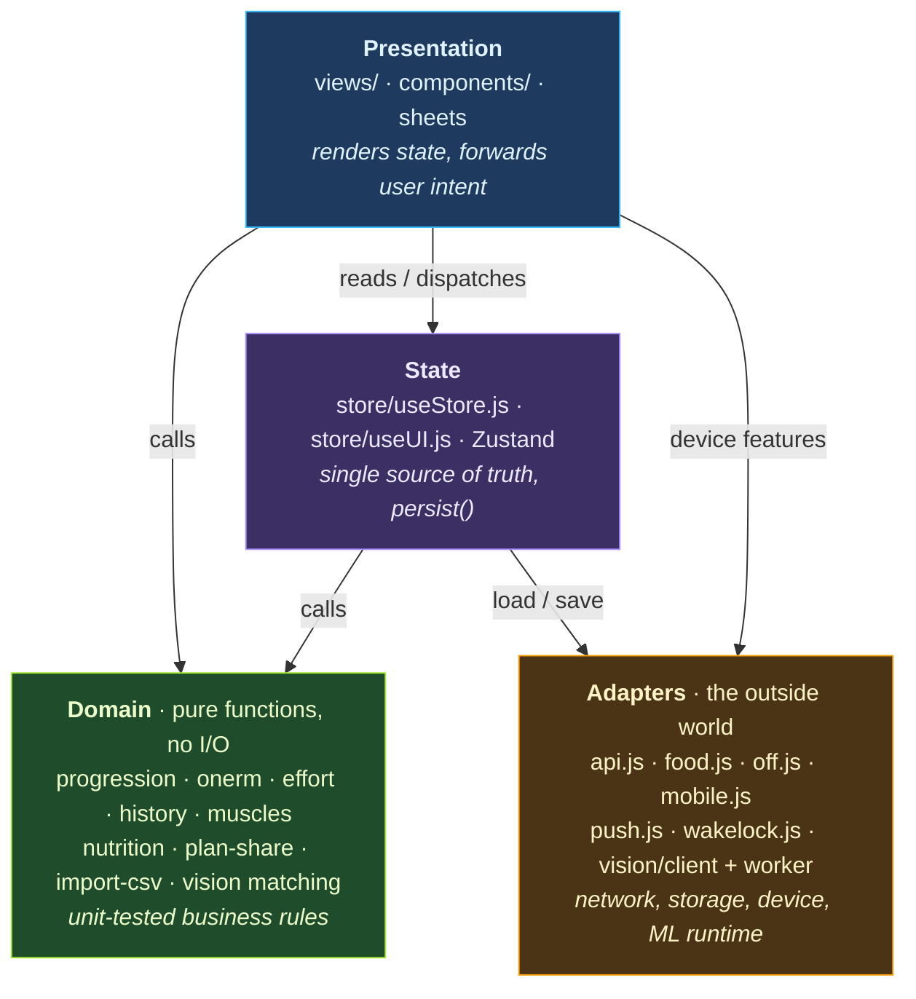

# OPENFIT architecture

One React codebase ships two ways: as a **self-hosted web app** with a small Node.js server, and as a **standalone Android app** that needs no server. The sections below go from the outside in: system context, the web request path, then the code layers inside the app.

  <picture>
    <source media="(prefers-color-scheme: dark)" srcset="images/architecture.png">
    <source media="(prefers-color-scheme: light)" srcset="images/architecture-light.png">
    
  </picture>

> [!TIP]
> **Interactive Architecture Diagram**: An interactive architecture canvas is available at [`architecture.html`](architecture.html) — open it in any browser to explore subsystem filters (Self-Hosted Web, Standalone Android, On-Device AI Vision, Food Search Proxy), inspect components, and trace data-flow paths.

## 1. System overview

```mermaid
flowchart LR
    subgraph CLIENTS["Clients (Offline-First)"]
        direction TB
        BROWSER["Browser / installed PWA<br/>React 19 + Service Worker"]
        ANDROID["Android app<br/>Capacitor 7 WebView shell"]
        STORE[("App local storage<br/>openfit-state.json")]
        ONNX["On-device AI<br/>ONNX WASM (CPU)"]
        ANDROID --> STORE
        STORE --> ONNX
    end

    subgraph SERVER["Self-hosted server · Docker Compose"]
        direction TB
        WEBC["Nginx web edge<br/>static React & reverse proxy"]
        APIC["Node.js 22 API<br/>pure stdlib HTTP server"]
        VOL[("Volumes<br/>./data · ./media")]
        WEBC -->|"/img"| VOL
        WEBC -->|"/api/*"| APIC
        APIC --> VOL
    end

    subgraph EXT["External & Model Hub"]
        direction TB
        OFF["Open Food Facts<br/>global barcode & food API"]
        HF["Hugging Face Hub<br/>~120MB food model"]
        PUSH["Web Push Service<br/>VAPID notifications"]
    end

    BROWSER -->|HTTPS :443| WEBC
    APIC -->|"food search (10-min cache)"| OFF
    APIC -.->|"push reminders"| PUSH
    ONNX -.->|"one-time model fetch"| HF
```

The Android app talks to no OPENFIT server. Its state lives in `openfit-state.json` in app-private storage.

## 2. Web architecture

A request from the browser goes through nginx, which serves the built app and exercise media itself and passes only `/api/*` to Node. The API is a single dependency-light Node process (no framework). It routes by `METHOD path` through one table to five handler groups, and every group reads and writes plain JSON files.

## 3. Code layers and separation of concerns

Inside the app the code is split into four layers. Dependencies point one way, from the UI down to the domain, and the domain layer has no React, no network and no storage. That keeps the training and nutrition rules testable as plain functions (18 test files, 253 tests).

If you come from Android, the layers map onto the usual Clean Architecture terms like this:

| OPENFIT layer | Folder | Android / Kotlin equivalent |
|---|---|---|
| Presentation | `views/`, `components/`, `*-sheets.jsx` | Composables / Fragments |
| State | `store/` (Zustand) | ViewModel + `StateFlow` |
| Domain | `lib/` pure modules, `lib/vision/` matching | Use cases + domain models (pure Kotlin) |
| Adapters | `lib/api.js`, `food.js`, `off.js`, `mobile.js`, `vision/client.js` | Repositories + data sources (Retrofit, Room, DataStore) |

Where the code does not follow the layering strictly:
- **No separate use-case objects.** Views call domain functions directly, the way a ViewModel would call a use case.
- **The domain doesn't depend on interfaces.** Unlike Clean Architecture in Kotlin, nothing is injected: each target picks its adapter with a build-time flag (`VITE_MOBILE`), and the code for the other target is removed when the app is built.
- **Three utility modules depend on the UI layer.** `i18n.js` and `wakelock.js` expose React hooks, and `glyphs.js` reads icon names from `components/Icon.jsx`. Because `format.js` imports `i18n.js`, part of the domain indirectly depends on React. Moving those hooks into `components/` would remove that dependency.

## Decisions

- [ADR-0001: Use cases only where they protect data](adr/0001-use-cases.md): why OPENFIT doesn't add a general use-case layer, and which flows get extracted into tested functions.
