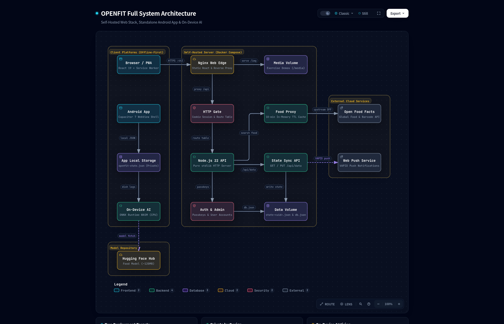
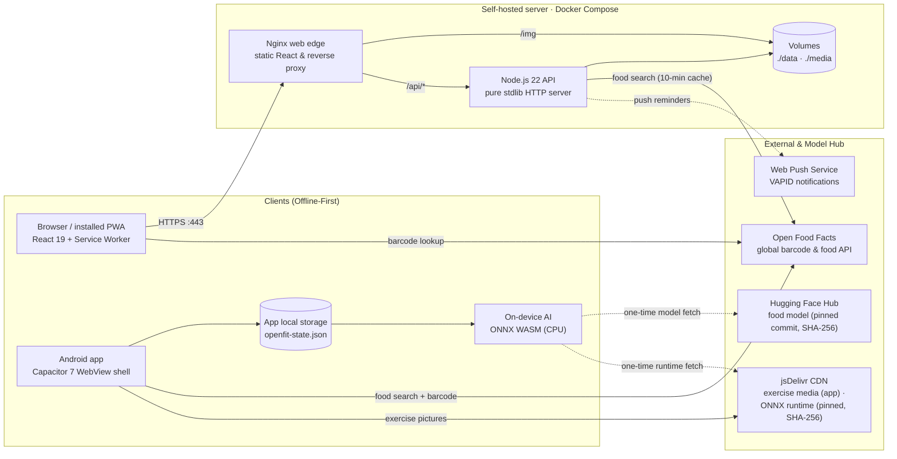
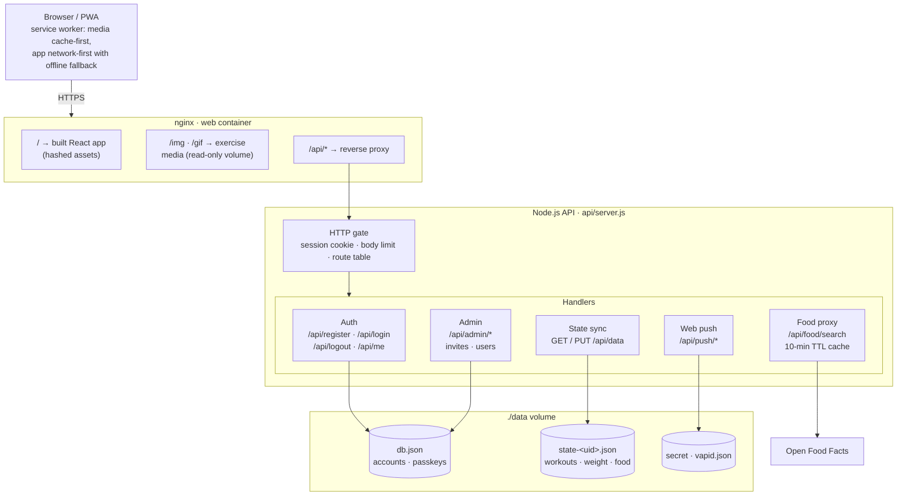
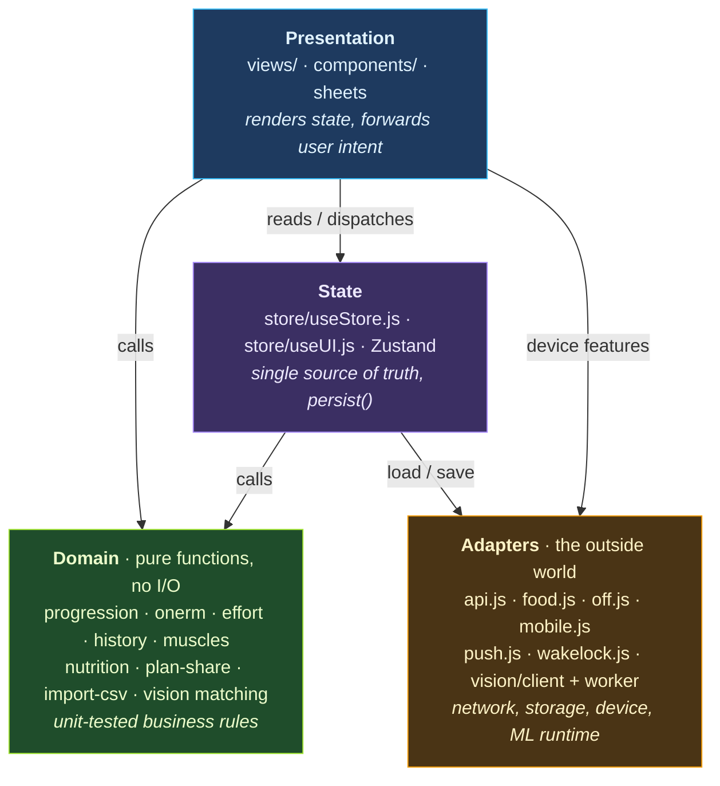

# OPENFIT architecture

One React codebase ships two ways: as a **self-hosted web app** with a small Node.js server, and as a **standalone Android app** that needs no server. The sections below go from the outside in: system context, the web request path, the code layers, then the app's own subsystems, trust boundaries and known risks (sections 4–6).

  <picture>
    <source media="(prefers-color-scheme: dark)" srcset="images/architecture.png">
    <source media="(prefers-color-scheme: light)" srcset="images/architecture-light.png">
    
  </picture>

> [!TIP]
> **Interactive Architecture Diagram**: An interactive architecture canvas is available at [`architecture.html`](architecture.html) — open it in any browser to explore subsystem filters (Self-Hosted Web, Standalone Android, On-Device AI Vision, Food Search Proxy), inspect components, and trace data-flow paths.

## 1. System overview

The Android app talks to no OPENFIT server. Its state lives in `openfit-state.json` in app-private storage. Its only network peers are Open Food Facts, jsDelivr and (once, on request) Hugging Face; the CSP in `frontend/index.html` lists exactly these (section 4).

## 2. Web architecture

A request from the browser goes through nginx, which serves the built app and exercise media itself and passes only `/api/*` to Node. The API is a single dependency-light Node process (no framework). It routes by `METHOD path` through one table to five handler groups, and every group reads and writes plain JSON files.

## 3. Code layers and separation of concerns

Inside the app the code is split into four layers. Dependencies point one way, from the UI down to the domain, and the domain layer has no React, no network and no storage. That keeps the training and nutrition rules testable as plain functions (37 Vitest files under `frontend/src`, about 490 `it()` cases by a source count; run `cd frontend && npx vitest run` for the live number).

If you come from Android, the layers map onto the usual Clean Architecture terms like this:

| OPENFIT layer | Folder | Android / Kotlin equivalent |
|---|---|---|
| Presentation | `views/`, `components/`, `*-sheets.jsx` | Composables / Fragments |
| State | `store/` (Zustand) | ViewModel + `StateFlow` |
| Domain | `lib/` pure modules, `lib/vision/` matching | Use cases + domain models (pure Kotlin) |
| Adapters | `lib/api.js`, `food.js`, `off.js`, `mobile.js`, `vision/client.js` | Repositories + data sources (Retrofit, Room, DataStore) |

Where the code does not follow the layering strictly:
- **No separate use-case objects.** Views call domain functions directly, the way a ViewModel would call a use case.
- **The domain doesn't depend on interfaces.** Unlike Clean Architecture in Kotlin, nothing is injected: each target picks its adapter with a build-time flag (`VITE_MOBILE`), and the code for the other target is removed when the app is built.
- **Three utility modules depend on the UI layer.** `i18n.js` and `wakelock.js` expose React hooks, and `glyphs.js` reads icon names from `components/Icon.jsx`. Because `format.js` imports `i18n.js`, part of the domain indirectly depends on React. Moving those hooks into `components/` would remove that dependency.

## 4. The app in detail (frontend/)

Stack: React 19, Vite 8, Zustand 5, react-router 7 (`HashRouter`), Capacitor 7 (Android; `ios/` exists but is not part of the release process). Android: `applicationId com.rupal2k.openfit`, minSdk 23, target/compile SDK 35, release `minifyEnabled false`; debug builds get the `.dbg` suffix and install beside the release app.

### State and persistence
- One Zustand store (`store/useStore.js`), state `S` shaped by `DEF` and repaired on every load by `normalizeState()` (routines and week via `lib/clean.js`, lab reports via `cleanReports()`, active workout shape check). Every write goes `update()` → `persist()` → `localStorage['gym_state_v1']`.
- **Android:** `persist()` also mirrors `S` to `openfit-state.json` in `Directory.Data` (800 ms debounce, flushed on `visibilitychange: hidden`). `boot()` restores from the file when it is newer than localStorage (`lib/mobile.js` `nativeLoad/nativeSave`). Legacy file `opengym-state.json` is still read.
- **Web, signed in:** the whole `S` (including `nutrition` and `labs`) is PUT to `/api/data` 1.5 s after a change, with `base` for 409 conflict merge (`lib/sync.js mergeState`). `S.active` is never stored server-side. Guest/demo builds stay local.
- UI state (`store/useUI.js`): sheet stack, toast, rest timer and work timer. Not persisted.

### Device-side subsystems added since 1.5

| Subsystem | Code | What it does | Network |
|---|---|---|---|
| Blood tests (Labs) | `views/Labs.jsx`, `lib/labs/*` | PDF text via bundled pdf.js (≤30 pages); scanned PDF (<40 text chars) or photo → Tesseract OCR in a worker with the English model bundled under `ocr/` (≤6 pages); `parse.js` reads rows without any model; `repair.js` fixes OCR decimal slips and flags them; review sheet (flagged/guessed/unsure rows start unticked); canonical SI storage with SI/US display (`units.js`); scores HOMA-IR, TG/HDL, ApoB/ApoA1, FIB-4, non-HDL, homocysteine, Omega-3 index, PhenoAge (`scores.js`, adult ages 18–120 only). Screen is `FLAG_SECURE` while mounted. | none (all assets bundled) |
| Food photo recognition | `vision-sheets.jsx`, `lib/vision/*` | Food-101 Swin classifier (`onnx-community/swin-finetuned-food101-ONNX`, pinned revision, int8 on CPU/WASM) in a module worker; top-3 labels mapped to bundled USDA table (`data/food101-foods.json`); the model never supplies numbers. Worker released after 90 s idle. | Hugging Face (model, once), jsDelivr (ONNX runtime, once) |
| Offline plan media | `lib/media-cache.js`, `App.jsx` | Picture + animation of every exercise in the user's routines saved into Cache API `openfit-media-v1` 3 s after the plan changes / when back online; `useMediaSrc` serves the cached copy first. | jsDelivr (app) or `img/`/`gif/` (web) |
| Interval formats | `lib/history.js`, `views/Workout.jsx`, `store/useUI.js` | Routine `format`: standard, `tabata`, `emom`, `amrap` (`cap` 60–3600 s). Timed sets chain to the next timed set in a superset/circuit or interval block (`chains`, `nextInRound`, `useUI.onRestEnd`); AMRAP runs one work clock. | none |
| Plan catalogue | `lib/starter.js` | `PLAN_TEMPLATES` grouped by `PLAN_WHERE`: Gym, At home, Home gym, Intervals. | none |
| Reminders (Android) | `lib/mobile.js syncReminder` | Local notifications ids 100–106, one weekly repeat per planned weekday, `allowWhileIdle`. Permission asked only from the Settings toggle. | none |
| i18n | `lib/i18n.js`, `src/locales/*.js` (11 packs + English source keys), `src/instr/` | English strings are keys; packs lazy-loaded; coverage tests fail on any missing key or placeholder. | none |
| Status bar | `App.jsx applyPrefs` | `@capacitor/status-bar` style follows the light/dark theme. | none |

### Content-Security-Policy
`frontend/index.html` carries a `<meta>` CSP used by both the web and Android builds: scripts `'self' 'unsafe-inline' 'wasm-unsafe-eval' blob:` (Capacitor injects its bridge inline; ONNX/Tesseract need wasm and blob workers); `connect-src` limited to `'self'`, jsDelivr, Hugging Face (`huggingface.co`, `*.huggingface.co`, `*.hf.co`) and `*.openfoodfacts.org`; images/media from `'self'`, `data:`, `blob:`, jsDelivr; `object-src 'none'`, `base-uri 'none'`, `form-action 'none'`. nginx sends no CSP header of its own (no `Content-Security-Policy` in `nginx.conf` or `web/nginx.conf.template`).

## 5. Trust boundaries (app)

| Boundary | Direction | Control in code |
|---|---|---|
| On-device health data (workouts, weights, meals, lab reports) | stays on the phone in the Android build | app-private file + localStorage; cloud backup excluded (`backup_rules.xml`, `data_extraction_rules.xml`); device-to-device transfer allowed; export only via share sheet, one cached copy (`shareExport`) |
| Imported files (backup JSON, plan JSON/CSV, other-app CSV/XML, lab PDF/photo, food photo) | untrusted → state | size caps (20 MB text, 25 MB lab file, 120 MP photo); plan import strict whitelist (`cleanRoutine(strict)`, `isKnownEx` rejects `__proto__`); every state load repaired by `normalizeState`; lab rows need the user's review before save |
| Downloaded model + runtime | CDN → code/weights executed in a worker | model files pinned to a commit and checked for size + SHA-256 after download (`verify` in `worker.js`); ONNX runtime `.mjs`/`.wasm` checked against hashes computed from `node_modules` at build time (`__ORT_RUNTIME__`) before it runs, re-checked on every load from cache, no unverified fallback |
| Open Food Facts | third-party data → food entries | `normalizeOFF` maps fields, bounds servings (0–5000); only the query/barcode is sent |
| Optional self-host server | browser ↔ `/api/*` | passkey session cookie (see FLOWS/PERMISSIONS); the app sends the full state, so lab reports and meals reach `state-<uid>.json` on the server for signed-in web users |
| Native bridge | WebView → Java | one local plugin, `PrivacyScreen.set({on})` (FLAG_SECURE); stock Capacitor plugins Filesystem, Share, LocalNotifications, StatusBar; `CapacitorHttp` enabled (patches `fetch` in the page) |

## 6. Known risks and assumptions

- **CapacitorHttp sidesteps the CSP on Android (inferred, unverified on device).** `capacitor.config.json` enables `CapacitorHttp`, which routes page-level `fetch` through native code (`lib/food.js` relies on this to skip CORS for OFF search). CSP `connect-src` does not govern native requests, so in the APK it is a list of intent rather than an enforced limit for main-thread `fetch`. Worker fetches (model download) are not patched (`lib/vision/worker.js` comment).
- **Model config files are not hashed.** `catalog.js` pins and hashes the `.onnx` weights; `config.json`/`preprocessor_config.json` are fetched at the pinned revision but not size/hash-checked.
- **The web service worker deletes every other cache on activate** (`public/sw.js`: keeps only `opengym-rt-v1`). After a SW update this removes `transformers-cache`, `openfit-ort-*` and `openfit-media-v1`; the verified-model marker stays in localStorage, but `refreshVision` also checks the cache, so the model just shows as not installed. Not active in the Android build (SW not registered there).
- **Server body limit vs. app import limit.** The app accepts imports up to 20 MB, `api/server.js` refuses bodies over 5 MB (`MAX_BODY`). A large state would stay local with `gym_dirty` set rather than sync.
- **Health data on the self-host server.** Lab reports are stored with birth year only (full DOB and file name dropped by `buildReport`/`cleanReports`), but they are in the server's state file in clear. `GET /api/admin/user` does not return `labs` or `nutrition`; anyone with disk access to `DATA_DIR` can read them.
- **Food photo input has no size check before `readOnce`** (`vision-sheets.jsx pickFile`), unlike Labs (25 MB) and text imports (20 MB). The image is shrunk to 512 px after it is read.
- **Scores are wellness information, not diagnosis** (`scores.js` header). Ranges are those printed on each report.
- No email, no scheduled server work beyond the API's in-process reminder loop, no embedded LLM agent, no public SEO routes: no `emails.md`, `cron.md`, `seo.md` or `automation.md`. The food classifier is a local model with a fixed output (top-3 labels), not an agent.

## Decisions

- [ADR-0001: Use cases only where they protect data](adr/0001-use-cases.md): why OPENFIT doesn't add a general use-case layer, and which flows get extracted into tested functions.

## Related Documents

| Document | Purpose |
|----------|---------|
| [FLOWS.md](FLOWS.md) | Step-by-step auth journeys with authz checks and trust-boundary crossings |
| [PERMISSIONS.md](PERMISSIONS.md) | Role × resource × operation matrix; code-enforced access control |
| [VARIABLES.md](VARIABLES.md) | Config and secrets map with risk ratings and pre-go-live checklist |
| [MOBILE.md](MOBILE.md) | Android build, native config (manifest, FileProvider, backup rules, plugins), signing and versioning |
| [RELEASE-CHECKLIST.md](RELEASE-CHECKLIST.md) | Full on-device regression required before every Android build |
| [PRD-openfit-labs.md](PRD-openfit-labs.md) | Product intent for blood tests (Labs) |
| [SELF_HOSTING.md](SELF_HOSTING.md) | Running the server with Docker Compose |
| [tests.md](tests.md) | Test coverage map: existing, proposed, and unverified rules (predates Labs, vision and interval formats) |
| [adr/0001-use-cases.md](adr/0001-use-cases.md) | Why OPENFIT has no general use-case layer |
